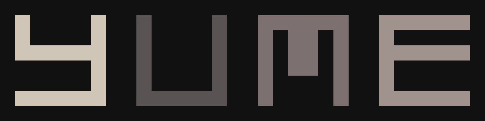
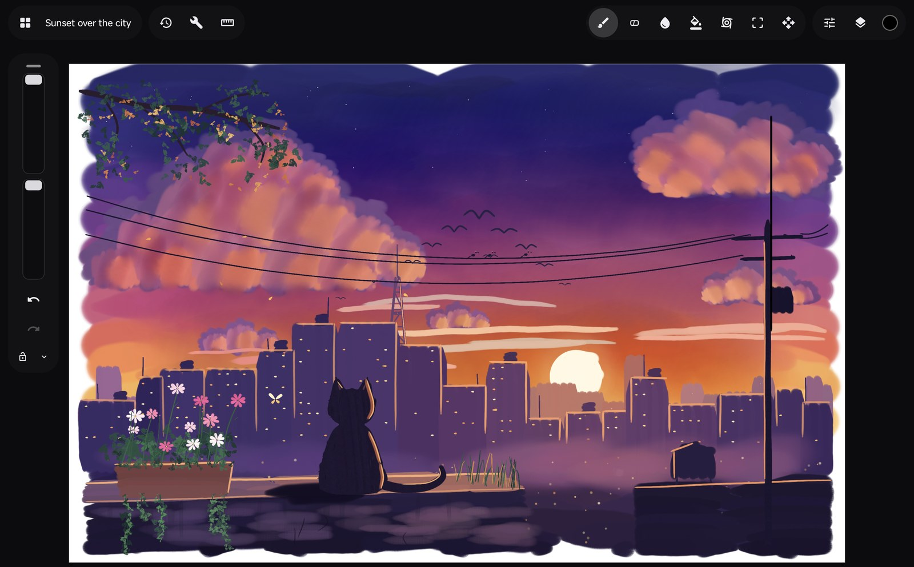
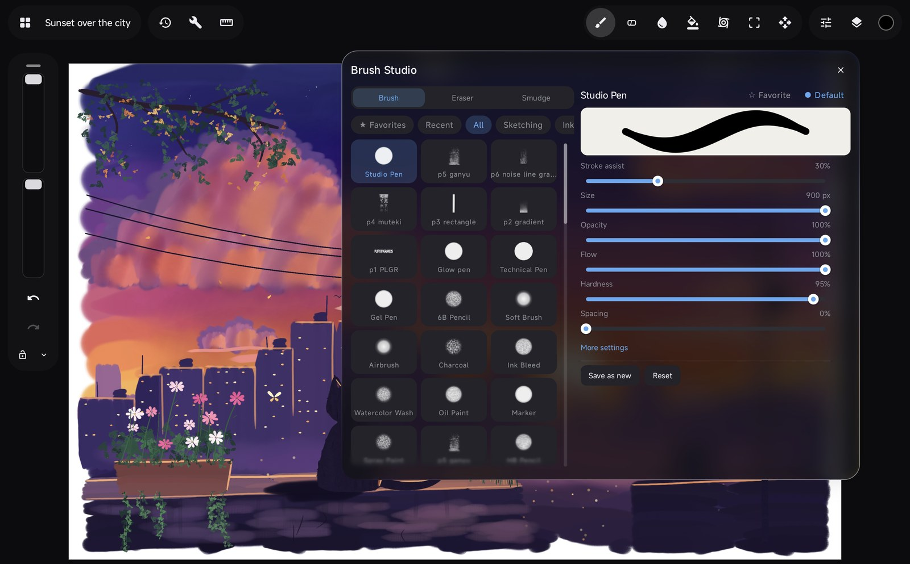
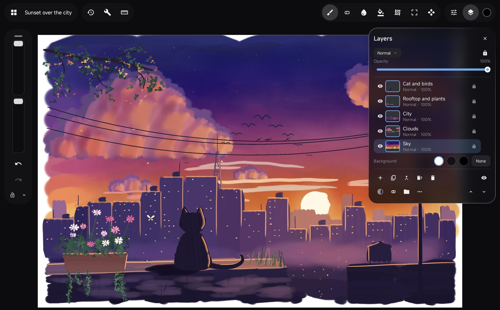
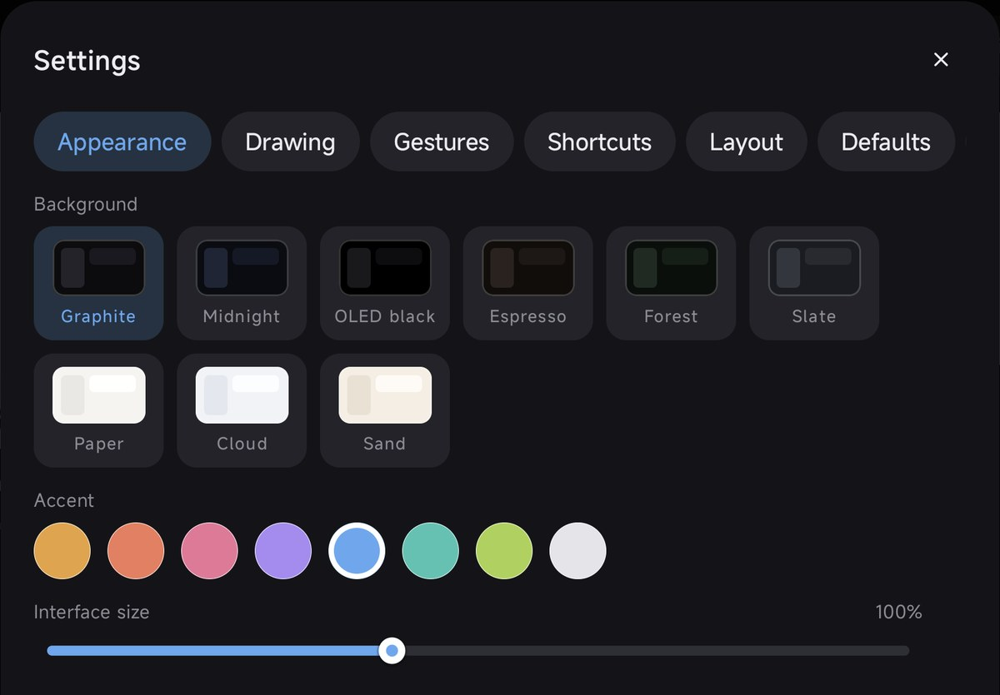
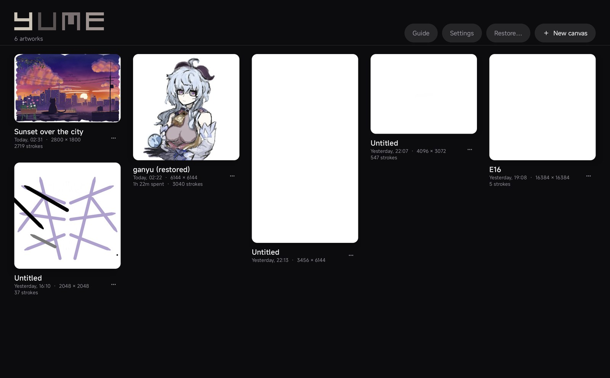

<p align="center">
  
</p>

<p align="center">
  <b>A painting studio for Android tablets and phones.</b><br>
  Pressure-sensitive brushes, layers, blend modes and canvases up to 16K, made for the pen.
</p>

<p align="center">
  <a href="../../releases/latest"></a>
  
  
  
</p>

<p align="center">
  
</p>

---

## Why Yume

Yume (夢, "dream") is a drawing and painting app built around a stylus on a
big screen. The canvas gets the whole display, everything else floats on frosted
glass, and every gesture, button and default can be changed in Settings.

- **Feels like paper.** Strokes follow pressure and tilt, a tremor filter smooths
  slow lines, and QuickShape snaps a held stroke into a clean line, arc or ellipse.
- **Goes big.** Sparse, tiled layers keep memory to the painted area, so a 6K
  canvas opens and paints like a small one (12K and 16K are there too, as
  experimental sizes).
- **Tablet or phone.** On a phone the tools move to a bar at the bottom, in
  thumb reach, and the gallery, Brush Studio and every panel rearrange for a
  narrow screen.
- **Never loses work.** Everything saves as you go, recovers after a crash, and
  the full undo history comes back when you reopen an artwork.

## Features

### Brushes


- 94 built-in brushes in groups: sketching, inking, calligraphy, painting,
  acrylic, airbrushing, textures, watercolour, elements, erasers and blenders.
- **Brush Studio** with a live stroke preview: size, opacity, flow, hardness,
  spacing, grain, jitter, pressure curves, tilt, velocity, colour dynamics, wet
  edges, wet mix and blend mode.
- **Import** Procreate (`.brush`, `.brushset`), Photoshop (`.abr`), Clip Studio
  Paint (`.sut`, `.sutg`) and GIMP (`.gbr`) brushes, several files at once.
- The hover cursor is the exact first dab of your stroke: shape, angle, size at
  the lightest pressure and blend mode.
- **Wet bleed** watercolour blenders that let colours run into each other.
- Favourites, recents, and any brush (imported ones too) as your default.

### Layers and colour


- Layers with opacity, 17 blend modes, clipping masks, layer masks, alpha lock,
  groups (pass-through, like Photoshop) and drag-to-reorder.
- Colour wheel, triangle, square, sliders, palettes and a **harmony** disc
  (opposite, split, analogous, triad and square schemes); eyedropper by holding the
  pen still; **ColorDrop** fills by dragging the colour chip onto the canvas.

### Tools
- Selection (freehand, rectangle, oval, automatic) with copy, cut, paste and
  copy all layers; transform with free, distort (perspective) and warp modes;
  a paint bucket that closes gaps in line art, follows a reference layer and
  sets its threshold as you drag; a clone tool that paints with pixels
  copied from another spot; gradient, shapes, liquify and text.
- Adjustments: hue, saturation, brightness, blur, noise, sharpen, motion blur,
  curves, levels, colour balance, gradient map, posterize and threshold, plus
  bloom, glow, glitch, halftone, chromatic aberration, mosaic, lens flare,
  clouds and anime background effects, and line
  art extraction (paper to transparent), with a
  live preview on one layer or all of them.
- Guides: grids, perspective with vanishing points, rulers, mirror and radial
  symmetry.
- One **Effects** panel with tabs: Adjust, Effects, Manga, Frames and
  Materials. Everything previews live on the canvas (pan and zoom freely)
  until you apply or cancel.
- Manga focus lines (touch to aim them) and speed lines.
- Comic frames laid out on a grid: drag panels of any size into place, move
  and resize them; they snap and never overlap.
- A materials library: screentones (dots, lines, cross-hatch, gradation),
  patterns and paper, canvas, grain and wood textures, over the whole canvas
  or inside the selection.

### Made for the pen
- Two-finger tap to undo, three to redo, four to hide the interface.
- A **shortcut ring** opens under two held fingers: touch an item to run it.
  Its items are yours to pick.
- Undo and redo buttons you can hold or slide along to scrub through history,
  and a history panel to jump to (or delete) any step.

### Yours to arrange


- Dark and light themes, accent colours and interface size.
- Rearrange or hide the top bar's pills and the toolbar's tools.
- Remap every gesture, the pen's button and keyboard shortcuts.
- Starting defaults for every tool: brushes, colour, selection shape, fill,
  gradient, shape, liquify and text options.

### Files


- A gallery of your artworks with pins, time spent and stroke counts.
- Export PNG, JPEG, WebP, PDF, Photoshop PSD (layers, groups and masks),
  OpenRaster (layers for Krita and others) or a
  **timelapse video** of the painting, with progress as it works.
- Open Photoshop PSD files as new artworks (RGB or greyscale, 8 or 16 bit).
- Back up and restore whole projects.
- A step-by-step, animated guide that walks through everything.

## Install

Download the APK from the [latest release](../../releases/latest) and open it on
your tablet (allow installs from your browser or file manager when asked).
Yume needs Android 10 or newer. It runs on phones too (the interface rearranges
itself for a narrow screen), but a tablet with a stylus is where it shines.

> The release APK is signed with a development key, so Android may warn about
> it, and it installs as a separate app from any Play Store build.

## Building from source

Requirements: Android Studio (or the Android SDK with JDK 17).

```bash
git clone https://github.com/samncg/yume.git
cd yume
./gradlew :app:assembleRelease
```

The APK lands in `app/build/outputs/apk/release/`. For a properly signed build,
create a `keystore.properties` next to `settings.gradle.kts` (see
`app/build.gradle.kts`); it is never committed.

## Under the hood

Kotlin and Jetpack Compose for the interface; the painting engine runs on its
own render thread with a stamped brush engine, sparse 256 px tile layers, a
disk-backed tile cache, a crash-recovery journal and a disk tier for undo
history. Every engine change is checked by an on-device harness against
recorded golden hashes.

The detailed engineering notes (architecture, stages, measurements and known
limitations) are in [docs/reference](docs/reference/README.md).
