# Yume

A Procreate-style painting studio for Android, written in Kotlin and Jetpack
Compose, with a stamped brush engine that runs on a dedicated render thread.

Everything is local: layered raster painting, pressure and tilt, selection,
transform, live adjustments, symmetry, and a timeline of every edit you make.
Documents are plain PNG layers on disk and are saved automatically.

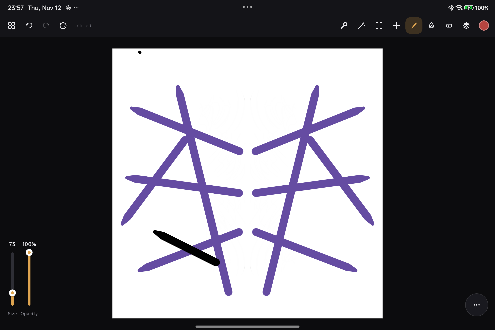

---

## Contents

- [Highlights](#highlights)
- [Gallery and documents](#gallery-and-documents)
- [The canvas](#the-canvas)
- [Gestures](#gestures)
- [Brush Studio](#brush-studio)
- [Colour](#colour)
- [Layers](#layers)
- [Selection](#selection)
- [Transform](#transform)
- [Adjustments](#adjustments)
- [Symmetry and canvas actions](#symmetry-and-canvas-actions)
- [History](#history)
- [Saving and recovery](#saving-and-recovery)
- [Interface tour](#interface-tour)
- [Architecture](#architecture)
- [Building and installing](#building-and-installing)
- [On-disk format](#on-disk-format)
- [Performance notes](#performance-notes)
- [Known limitations](#known-limitations)

---

## Highlights

- **Stamped brush engine** — 15 built-in presets across brush, eraser and
  smudge families, with pressure/tilt dynamics, grain, jitter and streamline.
- **Real smudge** — smudge brushes lift the pigment already on the layer and
  drag it, instead of painting a new colour.
- **Stroke assist** — global tremor damping plus a per-brush streamline amount,
  so freehand lines stay clean.
- **120 fps while painting** — measured on a Xiaomi Pad (3200 × 2136, 2048²
  canvas). The render thread only recomposites the dirty rectangle of a stroke.
- **Layers that behave** — 17 blend modes, opacity, alpha lock, live
  thumbnails, reorder/merge, and an *isolate layer* solo mode.
- **Selection and transform** — rectangle, oval, freehand and automatic
  selection; move, scale, rotate and flip; painting is clipped to the selection.
- **Live adjustments** — hue, saturation, brightness, blur, noise, invert and
  grayscale preview instantly while you drag and bake only when you apply.
- **Symmetry guides** — vertical and horizontal axes you can drag, lock and
  re-centre; strokes mirror as you paint.
- **Persistent history** — a panel of every action with its colour, size and
  brush, restored when you reopen the document, and individually deletable.
- **Autosave** — changes are written shortly after you stop, every 25 seconds,
  when the app goes to the background and when you leave the document.

---

## Gallery and documents

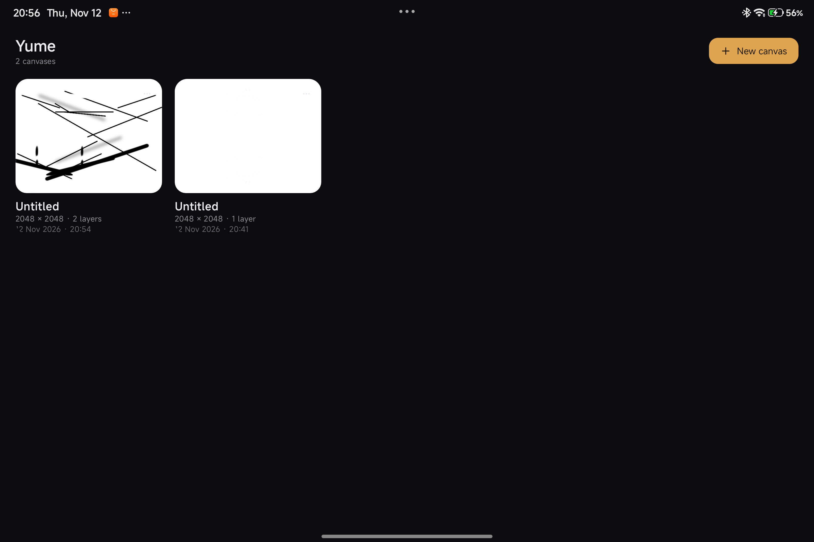

The gallery lists one card per document, most recently saved first, with a
rendered thumbnail, name, resolution, layer count and save time.

- **New canvas** — pick a preset or type any width and height (up to 9999 px
  per side). The dialog shows the exact pixel size and an estimate of how much
  memory each layer will use.
- **Open** — tap a card to enter the document.
- **Card menu** — long-press a card to rename, duplicate or delete it.
  - *Rename* reopens the document under a new name.
  - *Duplicate* copies the document, layers and history included.
  - *Delete* removes the document directory from disk.

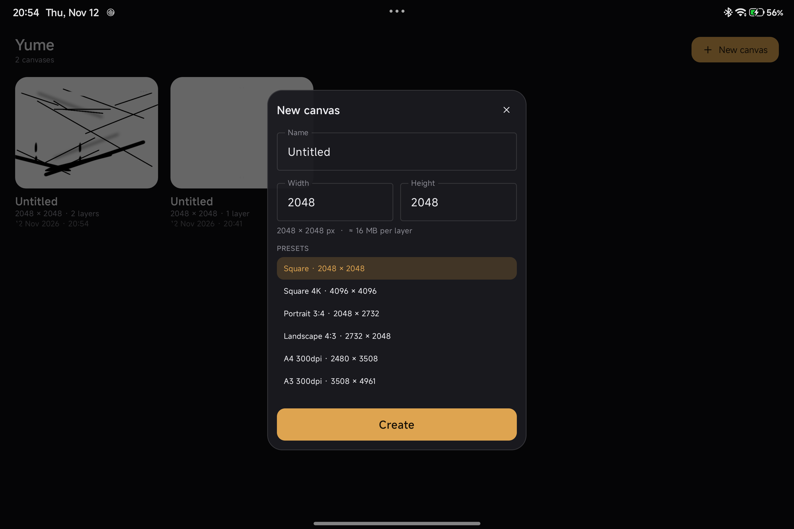

Presets cover square, 4K square, 3:4 portrait, 4:3 landscape, A4 and A3 at
300 dpi, and HD/4K/9:16 video sizes. Any other resolution can be typed in.

---

## The canvas

The document is a fixed-resolution pixel canvas. A SurfaceView is driven by a
dedicated render thread that composites visible layers and blits only the
changed region each frame.

- **Background** — white, black, cream or transparent (shown as a checkerboard).
- **Fit to screen / reset rotation / zoom in / out** live in the Actions panel.
- **Import image as layer** adds a PNG or JPEG as a new layer.
- **Fill layer with colour** floods the active layer with the current colour.
- **Export PNG to gallery** flattens the document and writes it to
  `Pictures/Yume`.
- **Hover cursor** — a ring the size of the brush follows a hovering stylus.
- **Palm rejection** — a finger never cancels a pen stroke. Finger painting can
  also be enabled or disabled explicitly.

---

## Gestures

| Gesture | Action |
| --- | --- |
| One finger / stylus | Paint, erase or smudge with the active tool |
| Two fingers | Pan, pinch to zoom, twist to rotate |
| Two-finger tap | Undo |
| Three-finger tap | Redo |
| Four-finger tap | Show or hide the interface |
| Long press at the start of a stroke | Eyedropper (sample the colour under the pen) |
| Hold still at the end of a stroke | QuickShape — snaps the stroke to a clean line, arc or shape |
| Long press a layer row, then drag | Reorder layers (and drop into a group) |
| Drag inside a selection | Move the selection outline |

Zoom, rotation and position are pivot-correct: the point between your fingers
stays under your fingers. QuickShape and the eyedropper can each be turned off
in the Actions panel.

---

## Brush Studio

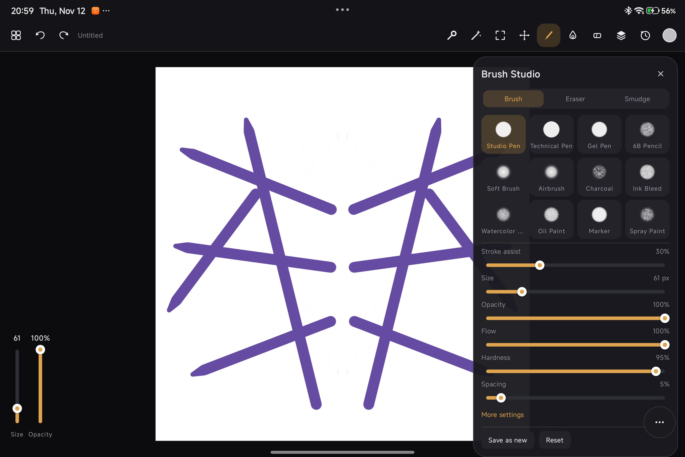

The Brush Studio opens from the brush, smudge or eraser button. It has three
families — **Brush**, **Eraser** and **Smudge** — each with its own list of
presets.

**Built-in presets (15)**

- Brushes: Studio Pen, Technical Pen, Gel Pen, 6B Pencil, Soft Brush, Airbrush,
  Charcoal, Ink Bleed, Watercolor, Oil Paint, Marker, Spray Paint.
- Erasers: Soft Eraser, Hard Eraser.
- Smudge: Smudge.

**Per-brush settings**

| Setting | What it does |
| --- | --- |
| Stroke assist | Global stabiliser that averages recent input to remove tremor |
| Size | Nominal stamp diameter in document pixels (1–300 px) |
| Opacity | Maximum coverage of the finished stroke |
| Flow | How much paint each individual stamp lays down |
| Hardness | Edge falloff of the stamp, from airbrush-soft to crisp |
| Spacing | Distance between stamps as a fraction of the brush size |
| Streamline | Per-brush smoothing on top of stroke assist |
| Grain | Baked procedural texture in the stamp |
| Jitter | Random scatter of stamp position and size |
| Pressure → Size | How much stylus pressure grows the stamp |
| Pressure → Opacity | How much stylus pressure increases coverage |
| Tilt → Size | How much stylus tilt widens the stamp |
| Smudge strength | Smudge presets only: how much pigment is picked up and dragged |

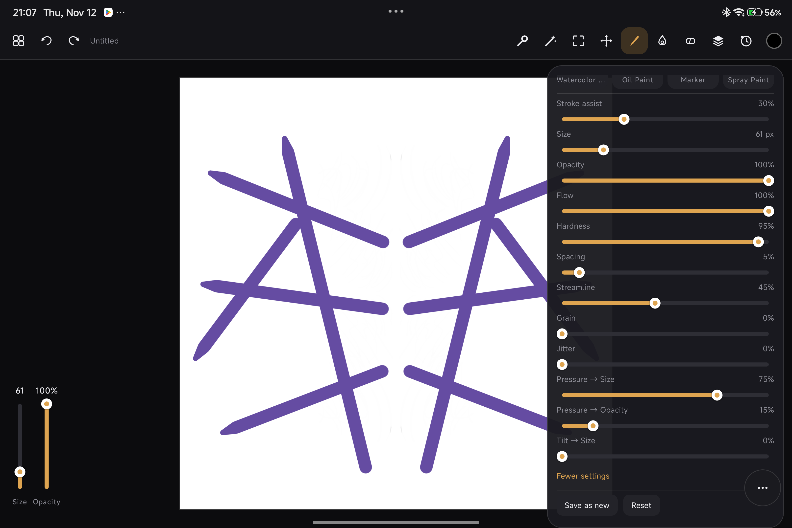

**Custom presets**

Adjust any brush and choose:

- **Save as new** — names the current settings and adds a preset to the active
  family, so you can build your own brushes, erasers and smudges.
- **Reset** — restores a built-in preset to its factory settings.
- **Delete** — removes a custom preset (built-ins cannot be deleted).

Presets are stored app-wide and survive restarts.

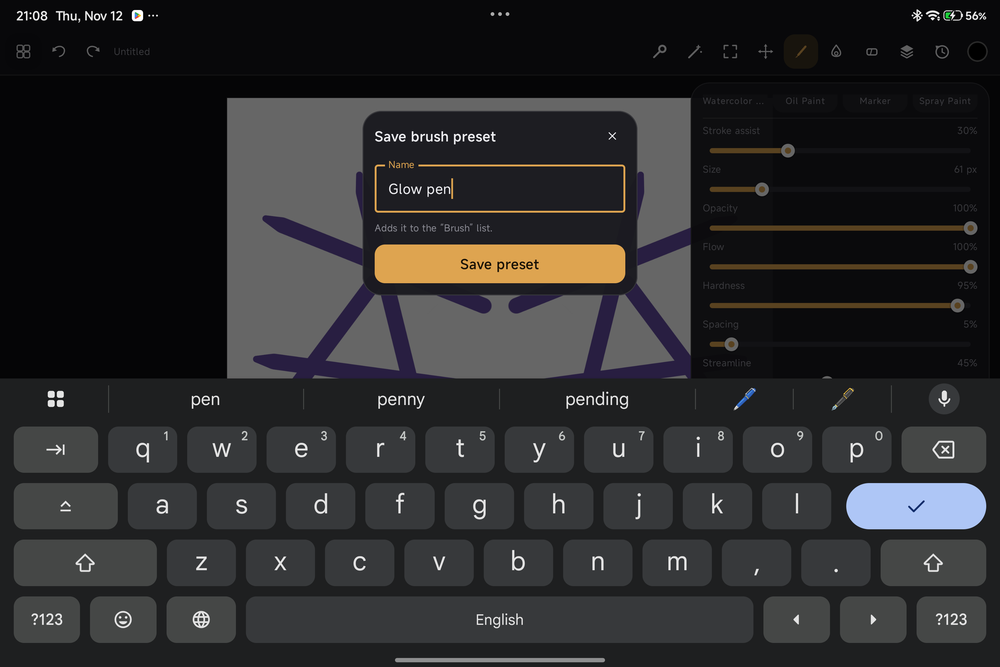

### How the engine paints

Every brush stamp is generated procedurally — a radial falloff shaped by
hardness, plus an optional baked grain texture — and cached per brush variant.
Stamps are placed at a spacing derived from the brush size, and each stamp is
scaled by pressure and tilt. A stroke is committed as one undo step covering
only the tiles it touched.

Each stamp is drawn in two passes. First the dab is resampled into a small
reusable scratch bitmap sized to the dab's own bounding box (plus a one-pixel
margin), which captures just the dab's coverage. Then the scratch is drawn into
the layer **1:1** with the real paint — colour filter, alpha and blend mode —
restricted to the dab's exact destination rectangle. The scratch follows the
brush, never the canvas, so painting memory is independent of the document size
and the same code path serves dense and tiled layers.

Smudge stamps copy the pixels under the previous stamp into a small reusable
buffer, mask them with the current dab, and draw them at the current position
with the smudge amount as alpha. That means the smudge actually moves the
colour that is already on the layer. The source region is read through the tile
store into a dab-sized patch, so a smudge across a tile seam samples exactly
the same pixels a single-bitmap layer would.

---

## Colour

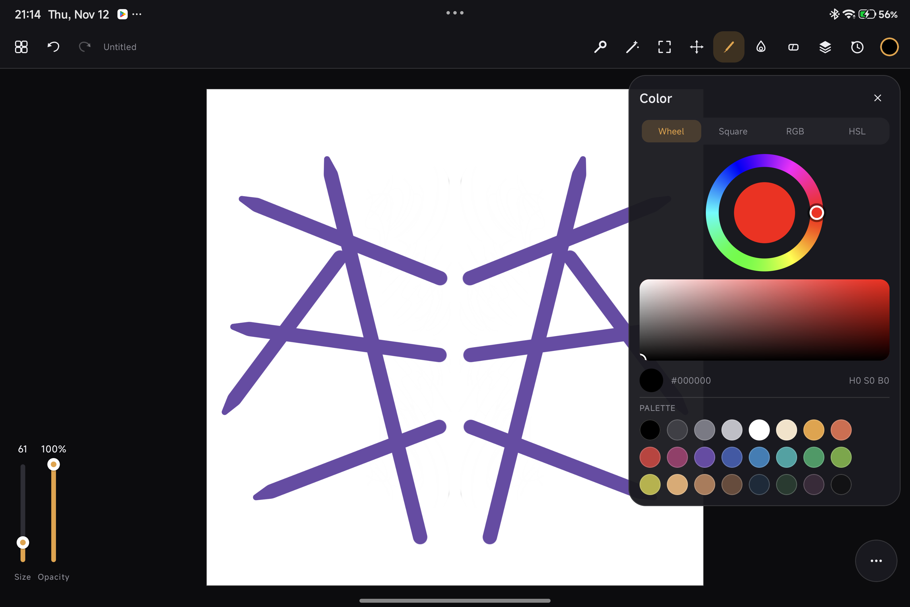

The colour panel supports four ways to choose a colour, switchable at any time:

- **Wheel** — hue ring around a saturation/value disc.
- **Square** — saturation/value square with a hue strip.
- **RGB** — numeric red, green and blue.
- **HSL** — numeric hue, saturation and lightness.

Every mode shows a live hex readout and the current colour. The panel also
includes:

- A **24-colour palette** for quick choices.
- **Recent colours**, collected when a colour is actually used to paint a stroke
  or fill a layer — merely picking a colour does not add it.
- **Eyedropper** by long-pressing on the canvas, or via the toolbar colour chip.

---

## Layers

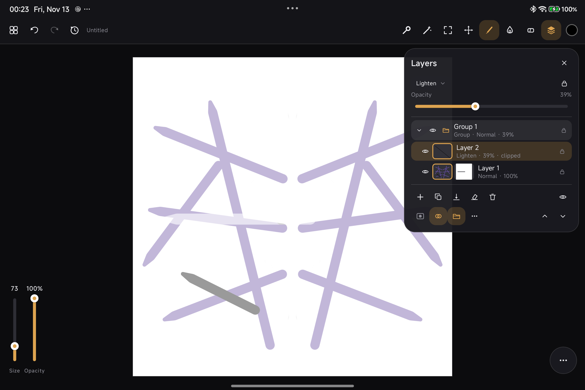

- **Add**, **duplicate**, **merge down** and **delete** layers.
- **Reorder by dragging** — long-press a layer row and drag it up or down. The
  row follows your finger and the stack reorders on release.
- **Rename** a layer or group with the **…** button (or by renaming the active
  row from the footer).
- **Lock** a layer with the padlock on its row; locks block painting, erasing,
  clearing, adjusting and transforming. Locked or hidden groups lock their
  children too.
- **Layer groups** — the folder button wraps the active layer in a group. Groups
  have their own **opacity**, **blend mode**, **visibility**, **lock** and a
  disclosure arrow. Drag a layer's row into a group's block to add it, or out of
  the block to remove it; expand/collapse with the arrow.
- **Clipping mask** — the chain button clips a layer to the alpha of the layer
  directly below it, so paint only shows where the layer underneath has pixels.
- **Layer masks** — the mask button adds a coverage mask to the active layer.
  Tap it again to switch between painting the pixels and painting the mask, and
  long-press it to remove the mask. Painting on a mask **hides** the layer where
  you paint; the eraser **restores** coverage. Each row shows both thumbnails,
  with the one you are editing outlined in the accent colour.
- **Blend modes** — Normal, Multiply, Screen, Overlay, Darken, Lighten, Color
  Dodge, Color Burn, Soft Light, Hard Light, Difference, Exclusion, Hue,
  Saturation, Color, Luminosity and Add (17 in total).
- **Opacity** per layer or group. The opacity of layers *inside* a group is
  controlled by the group (the slider is replaced by a note saying so).
  Changing an opacity is undoable: one drag records one history step.
- **Visibility** toggle per layer and group.
- **Alpha lock** — painting is clipped to pixels already on the layer.
- **Clear** wipes the layer (or the mask, while editing it).
- **Live thumbnails** update as you paint, plus a second thumbnail for masks.
- **Isolate layer** (Actions panel) shows a single layer and hides the rest, so
  you can work on it without the rest of the painting in the way. Toggle it off
  to show all layers again.

---

## Selection

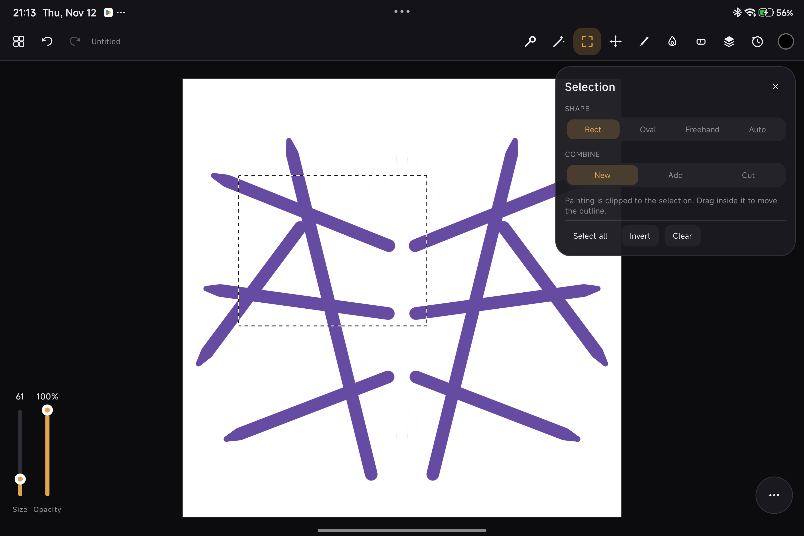

- **Shapes** — Rect, Oval, Freehand lasso and Auto (flood-fill of a colour
  region under the tap). Auto only acts on a **tap**: it is armed on touch-down
  and runs on release, and any finger movement of more than a few dozen screen
  pixels (at any zoom level) or a second finger cancels it. Dragging and pinching
  therefore never re-select, and never run the flood fill under your fingers.
  A tap *inside* an existing selection re-selects rather than moving it; drag
  inside the selection to move the outline.
- **Tolerance** — with Auto the panel shows a tolerance slider (1–100%) that
  controls how far a pixel's colour may differ from the tapped one. Low values
  pick only near-identical pixels, high values swallow anti-aliased edges and
  neighbouring tones.
- **Combine modes** — New (replace), Add and Cut (subtract).
- **Select all**, **invert** and **clear**.
- Painting and erasing are **clipped to the selection**.
- **Drag inside a selection** to move the outline.
- The outline is an animated marching-ants border that updates continuously
  while the canvas is idle.

---

## Transform

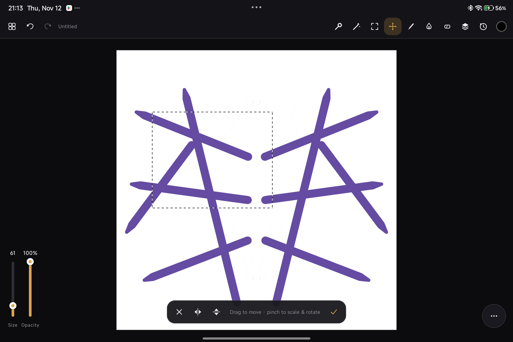

The transform tool moves, scales and rotates the active selection, or the
active layer when nothing is selected.

- **Drag** to move.
- **Pinch** to scale and rotate.
- **Flip horizontal** and **flip vertical** buttons in the transform bar.
- **Confirm** commits everything as a single undo step; **cancel** restores the
  previous state.

---

## Adjustments

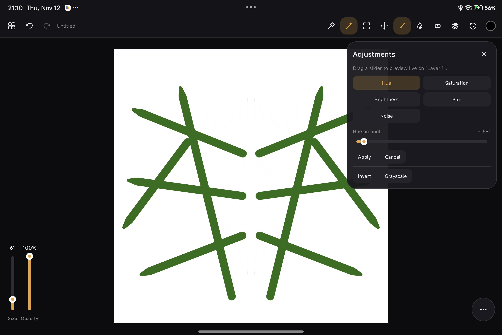

Adjustments apply to the active layer and preview **in real time** as you drag.

- **Hue**, **Saturation** and **Brightness** via GPU colour matrices.
- **Blur** using a quarter-resolution premultiplied box-blur proxy.
- **Noise** and **film grain**.
- **Invert** and **Grayscale** one-tap conversions.

The preview composites on the render thread at display rate; nothing is baked
until you press **Apply**. **Cancel** discards the preview and **closing the
panel keeps whatever you were previewing**.

---

## Symmetry and canvas actions

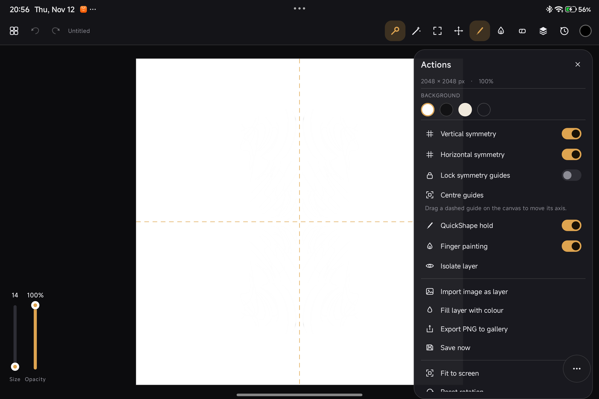

The Actions panel (wrench icon) contains canvas-wide controls:

- **Vertical symmetry** and **horizontal symmetry** — mirrored painting across
  an axis.
- **Draggable guides** — drag a dashed guide on the canvas to move its axis.
- **Lock symmetry guides** — prevents accidental dragging.
- **Centre guides** — resets both axes to the middle of the canvas.
- **QuickShape hold** — toggle the hold-to-snap gesture.
- **Finger painting** — allow or disallow touch painting.
- **Eyedropper: current layer** — sample the active layer instead of the visible
  composite.
- **Isolate layer** — solo the active layer.
- **Background** — white, black, cream or transparent.
- **Import image as layer**, **fill layer with colour**, **export PNG**,
  **save now**.
- **Fit to screen**, **reset rotation**, **zoom in**, **zoom out**.

---

## History

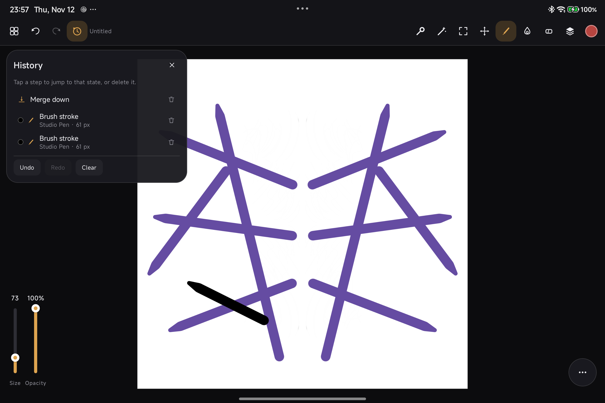

The history panel lives in the **top left** — the toolbar button sits beside
undo and redo — so it never covers the tool column. It lists every action in
the document with:

- A **colour swatch** matching the stroke colour.
- A **label** ("Brush stroke", layer operations, adjustments, transforms…).
- The **brush name and size** for strokes (for example "Studio Pen · 61 px").
- A **delete** button on each row.

Behaviour:

- **Tap a step** to jump back or forward to that state.
- **Delete any individual step** — its effect is removed and later steps are
  replayed.
- **Undo / Redo / Clear** buttons at the bottom.
- Steps that are currently undone stay visible, dimmed, so you can jump forward
  again.
- The panel is **restored when you reopen the document**, so your undo stack
  survives closing the app.

Delete requires the render thread to rewind, drop that action and replay the
rest; on very long histories this can take a moment.

---

## Saving and recovery

Yume saves automatically, so there is no "unsaved changes" state to manage:

- **Shortly after you stop drawing** — a change triggers a save 1.2 s later.
- **Every 25 seconds** while the document is open.
- **When the app goes to the background** (`ON_STOP`).
- **When you leave the editor** or close the app.
- **Save now** in the Actions panel forces an immediate save.

Saves are atomic-ish flat files per document: the manifest, one PNG per layer,
the thumbnail and the persistent history. A crash loses at most the last
moment of work.

---

## Interface tour

The layout deliberately follows Procreate:

- **Top-left** — gallery button, undo, redo, history, document name.
- **Top-right** — actions (wrench), adjustments (wand), selection, transform,
  brush, smudge, eraser, layers, colour.
- **Left edge** — vertical brush size and opacity sliders.
- **Bottom-right** — radial-style quick menu button.
- **Floating panels** open below the toolbar; the history panel opens on the
  left, every other panel on the right.
- **Four-finger tap** hides all chrome for a clean view of the artwork.

Every icon in the interface is drawn with Compose paths, so there are no bitmap
assets or icon-library dependencies.

---

## Architecture

```
ui/                       Compose interface
  EditorScreen            top bar, panel host, canvas sliders, transform bar
  Panels                  layers, brush studio, colour, adjustments,
                          selection, actions, history
  GalleryScreen           document browser and new-canvas dialog
  EditorController        loads a project, owns persistence and autosave
  Common                  shared controls (sliders, segmented rows, panels)
  Glyphs                  hand-drawn icon set

engine/                   drawing core (single render thread)
  DrawingEngine           layers, dirty-rect compositing, selection regions
  TileStore               per-layer pixel storage interface (dense or sparse)
  SingleTileStore         one full-canvas bitmap (reference, live default)
  SparseTileStore         256x256 sparse tiles, clipped to the canvas edges
  TileHistory             per-tile copy-on-touch capture and history patches
  StrokePainter           smoothing, stamp spacing, pressure/tilt dynamics,
                          smudge lifting, dab-scratch stamping
  BrushDab                procedural stamp generation and caching
  SurfaceRenderer         render loop, hardware canvas blit, overlays
  CanvasView              SurfaceView and pointer/gesture handling
  DrawingSession          command queue between UI thread and render thread
  History                 undo/redo patches, labels, and replay
  TransformSession        free transform of a layer or a selection
  Adjustments             colour matrices and premultiplied box blur
  SelectionUtil           region outlining and flood fill
  AllocTracker            debug-only counter of canvas-sized bitmap allocs
  FrameLogger             debug-only rolling fps and p50/p95/p99 frame time
  Enums                   tools, shapes, blend modes, colour modes

data/
  ProjectStore            manifest JSON, layer PNGs, thumbnail, history
  PresetStore             brush presets in SharedPreferences
```

**Threading.** The UI never touches bitmaps. Compose posts commands and raw
pointer events into lock-free queues that the render thread drains. The render
thread publishes an immutable `EditorUiState` snapshot back through a
`StateFlow`, so Compose recomposes from data instead of mutating view state.

**Layer storage.** Layers keep their pixels behind `TileStore`. The live
default is `SingleTileStore` (one bitmap, behaviourally identical to the old
engine); the debug switch `TileStoreConfig.useSparseLayers` selects
`SparseTileStore`, which holds only the 256² tiles that contain paint and treats
a missing tile as the store's default pixel (transparent for layers, opaque
white for masks). Both stores stamp through the same **dab scratch**: a dab is
resampled into a brush-sized bitmap and then written 1:1, so a stroke costs a
few tile blits per dab and never touches a canvas-sized surface. See the
performance notes for the measured difference against the pre-2b-4
canvas-width band.

**Sparse history.** A sparse stroke captures each tile once, on first touch.
The resulting action stores before/after crops clipped to the stroke's
rectangle (absent = default), so undo, redo, jump-to-step and delete-with-replay
restore exactly the pixels the dense rectangle patch would, while memory scales
with the area the stroke covered rather than with its bounding box.

**Sparse persistence.** Sparse layers are still opt-in, but they round-trip
exactly: the harness builds the same document (layers, a default-white mask, a
group, a hidden layer, a reorder, a delete and a layer released to disk) on both
stores, saves through `ProjectStore`, reloads through the real load path and
compares layer/mask pixel CRCs and the saved PNG bytes. All four cases (2000x1333
and 1500x1000 at tile 64 and 256) match.

**Frame timing.** `FrameLogger` (debug only, no cost when disabled) measures
frame time while a stroke is active and reports rolling fps plus p50/p95/p99 and
max, so every fps number in this document comes from the same instrument.

**Undo.** Pixel edits store only the before/after pixels of the rectangle a
stroke touched. Structural edits (adding or deleting a layer) store full layer
snapshots. History is capped at roughly 320 MB.

**Compositing.** Each stroke tracks a dirty rectangle. The renderer
recomposites just that rectangle, then blits it to the surface, so per-frame
cost scales with what changed rather than with canvas size. In sparse mode the
composite is itself a **sparse tile store** whose default pixel is the canvas
background: compositing walks only the tiles the dirty rectangle touches, and
within a tile composites every visible layer in order with its blend mode,
opacity, mask, clipping and group. Blank regions cost nothing and are never
allocated, so the 64 MB composite surface of the dense build becomes, for a
mostly-empty 4096² document with 20 layers, about 21 MB.

**Tile-sized scratch.** The group buffer, the clipping/mask buffer and the
pre-stroke snapshot stop being full-canvas surfaces in sparse mode. Group and
layer buffers are allocated per tile geometry (at most four sizes: a full tile
and a clipped edge tile, per axis) and the blit back is an integer translation
of a bitmap that is exactly the size of the region, so it never resamples. The
pre-stroke snapshot is the per-tile `TileCapture`; `strokeBase` is never
allocated for a sparse document, and painting allocates no canvas-sized bitmap
at all — only the brush-sized dab scratch.

**Zoomed-out mip.** `DrawingEngine` keeps a quarter-scale mip of the composite
as its own sparse store. Fit-to-screen on an 8192² document would otherwise
blit a thousand full-resolution tiles per frame; the mip reads a handful. Each
mip tile covers 4x4 document tiles and is regenerated from exactly that
document region, so a partial dirty update produces the same mip as a full
rebuild. The renderer switches to it below 0.4x zoom.

**Allocation gate.** `AllocTracker` (debug only) counts every bitmap whose size
equals the canvas size, grouped by creation site. It exists so the harness can
prove that a sparse stroke allocates **no** canvas-sized surface (the dab
scratch is brush-sized); the counter is off in release builds. A sparse
document may build one canvas-sized surface for the PNG encoder, under the
single `encode.canvas` site that both "Save now" and export use.

**One-shot operations.** Transforms, adjustments, merges, duplicates, fills,
clears and imports work one tile at a time (`TileOps`, `TransformSession`), so
their cost tracks the tiles they touch. A colour matrix is applied per tile (it
has no neighbourhood, so the pixels are identical); a blur is computed from a
patch grown by the full support of its three passes (3 x radius), so a tile seam
cannot appear and the edge clamp matches the whole-surface pass; grain is a hash
of the absolute canvas position, so it does not depend on tile layout. The undo
entry for all of them is the per-tile `TilePixelAction`.

**Stroke-scoped composite cache.** Rebuilding a tile blends every visible
layer, so a 30-layer document costs 30 draws per dirty tile per frame. While a
stroke is live the engine caches the flattened layers *below* the active layer,
per tile, for the tiles the stroke touches: a frame then composites about three
things instead of the whole stack. The cache is filled by the normal
compositing code and drawn back with `SRC`, so a cached tile is bit-identical
rather than approximate. It is dropped when the stroke ends, and it is disabled
when the active layer is inside a group or is a clipping layer, because those
two cases cannot be split from the stack above them.

**Auto-select, one algorithm.** The magic wand reads the composite through
`WandGrid`, which fills 256-pixel cells on demand and keeps a tile-granular
visited set, so selecting never materialises a canvas-sized bitmap. That is the
*only* selection algorithm in the build: the dense store and the sparse stores
all read through the same grid and return bit-identical regions (36/36 cases on
both canvas shapes). The previous whole-image implementation was removed from
the app; the harness keeps a copy purely as the reference it is measured
against. On even canvas dimensions the two agree exactly; on an odd height the
old path downscaled the whole image by 1333/666 = 2.0015 while each grid cell is
downscaled by exactly 2, so a handful of pixels cross the tolerance boundary
(4-460 px per case, at most 0.02% of the selection).

**Warmup.** Opening a document pre-allocates the brush-sized dab scratch and
the smudge patch on the render thread, so the first stroke does not allocate
inside the gesture. Neither is canvas-sized.

---

## Building and installing

Requirements: **JDK 17**, **Android SDK 35**, and a device on **Android 10
(minSdk 29)** or newer.

```bash
./gradlew :app:assembleDebug
adb install -r app/build/outputs/apk/debug/app-debug.apk
```

`gradle.properties` pins `org.gradle.java.home`; if your JDK lives elsewhere,
override it or set `JAVA_HOME` before invoking the wrapper.

---

## On-disk format

Each document is a directory under the app's private files:

```
files/projects/<uuid>/
  manifest.json        name, size, background, layer order, opacity,
                       blend modes, active layer, symmetry settings
  layer_0.png          one PNG per layer, full canvas size
  layer_1.png
  thumb.png            512 px gallery thumbnail
  history.json         the persisted undo run and its applied position
  history/
    h<id>_b.png        before/after patch for one history entry
    h<id>_a.png
```

Layers are stored uncompressed as ARGB PNGs, so the directory is inspectable
and editable with ordinary image tools. Brush presets live separately in
`SharedPreferences`, which keeps them shared across documents.

The on-disk format is unchanged by sparse layer storage: SparseTileStore keeps
only *in-memory* tiles and always saves the full `layer_N.png` / `mask_N.png`,
so documents written by either store open in the other and in the old build.

---

## Performance notes

- Canvas rendering happens on its own thread; Compose only sends events and
  receives state snapshots.
- Stroke updates composite only the dirty rectangle.
- Layer previews are downscaled and are refreshed on the render thread.
- Adjustment previews are GPU colour matrices, and blur works on a
  quarter-resolution proxy, so dragging a slider stays interactive.
- Brush stamps are generated once per brush variant and cached as bitmaps.
- Smudge reuses a single 128² scratch buffer per stroke.
- The magic wand reuses one pixel buffer, one mask and one growable stack, so
  repeated auto-selections do not allocate or churn the GC. Its region is built
  from vertically coalesced rectangles in a single `setPath`, and the marching
  ants outline comes from Skia's native boundary path — building it per scanline
  and probing `region.contains()` per edge pixel used to freeze the app when a
  large blank area was selected.
- **Hidden layers are swapped to disk.** After a save, if the resident layer
  pixels exceed a fifth of the heap, hidden layers are written to
  `cache/l<layerId>.png` and dropped from memory; they reload transparently when
  shown again. Visible layers stay resident because the compositor needs them.
- **Sparse layers cost memory in proportion to paint, not canvas size.** With
  `useSparseLayers` on, a 4096² document with 20 mostly-empty layers holds about
  43 MB of layer pixels instead of 1280 MB. The live default is still
  `SingleTileStore` until sparse layers are promoted after eviction lands.
- **Sparse composite and scratch are tile-sized.** With `useSparseLayers` on,
  the composite, the group buffer, the clipping/mask buffer and the pre-stroke
  snapshot all scale with painted area instead of canvas area. For the same
  4096² / 20-layer document the composite holds about 21 MB instead of 64 MB,
  the group and clipping scratch are one tile each (256 KB) instead of 64 MB
  each, and `strokeBase` is not allocated at all (per-tile capture instead).
- **Painting allocates no canvas-sized bitmap, dense or sparse.** A debug
  allocation counter (`AllocTracker`) records every bitmap whose size equals the
  canvas size. During a 2000-event sparse stroke on 2048² and 4096² with 1 and
  20 layers the table is empty (`alloc=[none]`); the harness fails if any site
  outside `encode.canvas` appears. The dense build reports
  `engine.composite`, `engine.strokeBase` and one `engine.newLayer` per added
  layer, which is what the counter is there to catch. The pre-2b-4 build
  reported `stroke.band=1`: a canvas-width, canvas-height surface (8 MB at
  2048², 64 MB at 4096², 256 MB at 8192²).
- **Dab scratch instead of a stamping band.** Each dab is resampled into a
  brush-sized scratch (plus a 1 px margin) and then blended into the layer 1:1
  with the real colour filter, alpha and blend mode. Colour filter, alpha and
  blend therefore run in one pipeline — the same pipeline as drawing the dab
  straight onto a dense layer — and the only extra step is that the resampled
  coverage is rounded to 8 bits once. Measured against the old band build on
  2048²: a hard stroke changes 229 pixels, all within 2/255; a soft stroke
  changes 16 760 pixels (0.40% of the canvas) with 98% of them within 2/255 and
  the worst at 4/255. The one place the rounding is amplified is smudge, whose
  read→write feedback re-samples its own output: there the difference reaches
  25/255 on 942 pixels (0.02% of the canvas) at dragged high-contrast edges.
  See `docs/golden_hashes.txt` (Stage 2b-4) and `docs/diffs_v2/`.
- **The eraser is the only brush whose single dab exceeds 2 LSB.** A one-off
  single dab differs from a one-pass draw by 5/255 on 950 px, because DST_OUT
  computes `dst * (1 - srcA)` and the pre-rounded coverage is multiplied by both
  the destination and the paint alpha. Binding the dab as a `BitmapShader` and
  blending it in one pipeline made the eraser bit-identical, but a shader's
  combined matrix includes the canvas translation, so dense and sparse stopped
  agreeing from the eraser phase on. That is the same translation sensitivity
  the band existed to avoid, so the experiment was reverted; 5/255 is inside the
  accepted policy.
- **The painted pixels are deterministic.** Three independent runs in fresh
  processes produce byte-identical dense oracles for all 59 phases on both
  canvases; brush jitter uses a fixed seed and noise is keyed on canvas position.
- **All large v1/v2 differences sit on edges.** Every pixel that differs by more
  than 16/255 is within 3 px of a real edge in the composite (measured as a
  colour range > 8 in a 7x7 box, which also catches wide soft ramps): 0 pixels
  fail that test in any phase. The hard brush changes 229 px by <= 2/255, and the
  soft stroke's 16 760 changed pixels are 98% <= 2/255.
- **Sparse stroke benchmark.** On a 2048² canvas with a 64 px hard brush, 2000
  move events take 111.6 ms on `SingleTileStore` and 117.6 ms on
  `SparseTileStore` (about 1.5 tile write-backs per dab). That is 5% over the
  dense number in the same run. Counters: 1562 dabs, 2361 tile draws, 6.97 M px
  written back.
- **Frame logger.** `FrameLogger` (debug only, behind a flag, zero cost when
  off) records frame times while a stroke is active and reports rolling fps plus
  p50/p95/p99/max. Harness measurements, where a frame is 8 input events plus the
  dirty-region composite (budget at 120 Hz is 8.33 ms):

  | canvas | store | layers | p50 | p95 | p99 | max |
  | --- | --- | --- | --- | --- | --- | --- |
  | 2048² | dense | 1 | 0.47 | 0.63 | 0.68 | 7.2 |
  | 2048² | dense | 20 | 0.41 | 0.56 | 0.60 | 24.9 |
  | 2048² | sparse | 1 | 0.40 | 0.92 | 1.53 | 50.0 |
  | 2048² | sparse | 20 | 0.44 | 1.10 | 1.94 | 66.3 |
  | 4096² | dense | 1 | 0.57 | 0.77 | 0.83 | 20.2 |
  | 4096² | sparse | 1 | 0.73 | 1.28 | 1.96 | 128.5 |
  | 4096² | sparse | 20 | 1.08 | 1.85 | 2.75 | 205.9 |

  All are milliseconds and all sit far inside a 120 Hz frame. The harness gate
  is p99 < 6 ms at 2048²; 4096² is reported against the 8.33 ms frame budget.
  Every row above passes both. The multi-frame `max` spikes are the device's
  scheduler, not the stroke.
- **Zoomed-out mip.** A quarter-scale mip of the composite is rebuilt only for
  dirty regions. On both 2048² and 1000x700 a partial update produces exactly the
  same mip as a full rebuild. Against a single `createScaledBitmap` of the whole
  composite it differs on `maxch=1` for 15 466 px (2048², 0.37%) and 6 298 px
  (1000x700, 0.9%), because per-tile downscaling rounds 1 LSB differently from
  one full-canvas downscale. The mip is display-only; the canvas itself is not
  affected.
- **Sparse memory.** 20 mostly-empty 4096² layers: 43 MB of layer pixels, 21 MB
  composite, 0 MB snapshot, 0 MB scratch, and no stamping band at all (the dab
  scratch is brush-sized). The dense build needs 1280 MB of layer pixels, 64 MB
  composite and 64 MB snapshot and cannot allocate the 20-layer case at all.
- **Painted-stack frame times.** Each layer painted over 15-80% of the canvas with
  real tile content, mixing Normal / Multiply / Overlay, one group, one clipping
  layer and one masked layer; a frame is 8 input events plus the dirty-region
  composite. `gc` is the ART collection count and total pause time during the
  measured stroke, from `Debug.getRuntimeStat`:

  | canvas | store | layers | fill | p50 | p95 | p99 | gc |
  | --- | --- | --- | --- | --- | --- | --- | --- |
  | 2048² | dense | 10 | 80% | 0.77 | 0.99 | 1.01 | 0 / 0 ms |
  | 2048² | sparse | 10 | 80% | 0.77 | 1.92 | 2.89 | 0 / 0 ms |
  | 2048² | dense | 30 | 60% | 1.18 | 1.47 | 1.49 | 0 / 0 ms |
  | 2048² | sparse | 30 | 60% | 0.98 | 4.53 | **5.29** | 1 / 28 ms |
  | 4096² | dense | 10 | 50% | 1.53 | 2.06 | 2.12 | 0 / 0 ms |
  | 4096² | sparse | 10 | 50% | 2.89 | 6.36 | **9.06** | 1 / 27 ms |
  | 4096² | sparse | 30 | 30% | 5.11 | 9.68 | **12.49** | 1 / 29 ms |
  | 4096² | sparse | 30 | 15% | 4.04 | 9.34 | **10.40** | 1 / 36 ms |

  Milliseconds. Every 2048² row passes the p99 < 6 ms gate (worst 5.29 ms at
  30 layers / 60% fill). The 4096² rows miss the 8.33 ms frame budget and are
  reported, not gated; the device test is the judge, and the tail analysis below
  explains what they are.
- **Where the 4096² frame time goes.** `CompositeProfile` (debug only) counts
  tile visits, layer draws, tile lookups, opacity queries and cache hits, and
  accumulates `System.nanoTime` per category (composite pass, dab paint, tile
  blits, opacity scans) plus the tile bitmaps newly allocated and the tiles
  copied by the undo capture, per frame. On 4096² sparse with 10 layers a
  150-frame painted stroke visits 291 composite tiles, performs 1914 layer draws
  and 12 non-empty tile lookups; over the whole stroke the composite pass totals
  270 ms, painting 210 ms and tile blits 5.3 ms, and the stroke allocates 63 tile
  bitmaps and captures 60. At 30 layers the composite pass totals 453 ms,
  painting 195 ms, blits 9.3 ms, 340 allocations, 60 captures. So the composite
  pass, not the stroke path, is the per-frame cost at 4096², and it is almost
  exactly proportional to how many 256 px tiles a frame touches (see the tail
  latency note below).
- **4096² tail latency is tile-crossing frames, not a pathology.** Per-frame
  profiling of a 150-frame painted stroke at 4096² splits every frame into
  composite, paint, blit, opacity, tile count and newly allocated tiles. The
  worst 1% are exactly the frames where the stroke crosses into new 256 px
  tiles: the dirty rect is rounded up to whole tiles, so such a frame composites
  2x2 = 4 tiles instead of 1-2 and allocates 4-6 tile bitmaps. At 10 layers the
  median frame is 2.87 ms (composite 1.71, paint 1.13, 1 tile) while the slowest
  is 10.11 ms (composite 7.05, 4 tiles, 4 allocated); at 30 layers 5.18 ms
  median vs 12.73 ms (composite 8.44, 4 tiles). The cost tracks tile count
  almost exactly 4x, and paint and blit stay flat, so the allocation is not the
  cost. Pooling tile bitmaps would not help; compositing only a tile's dirty
  sub-rect would, but it changes the scratch-buffer geometry per frame and would
  re-baseline the exact-hash compositor tests, so it is left to Stage 3.
- **Compositor fast paths** (each verified by the stroke-cache and
  composite-invalidate tests, which is why they may be enabled at all):
  `drawIntoRectPreClipped` drops a save/clipRect/restore pair per tile and hoists
  the row-to-tile key bits; a per-tile "fully opaque" flag (invalidated on any
  write to that tile) lets an opaque Normal layer skip every layer below it;
  and the stroke cache flattens everything below *and above* the active layer
  per touched tile. The above cache is only built when every layer above is
  plain Normal, ungrouped, unmasked and unclipped, because OVER is associative
  and Multiply/Overlay are not.
- **One-shot operations allocate nothing canvas-sized.** With the allocation
  counter on, a sparse 1024² document with a group and a mask runs
  `transform-move`, `adjust-blur`, `adjust-hue`, `invert`, `grayscale`, `merge`,
  `duplicate`, `fill`, `clear` and `wand` with an empty table; `flatten` (the
  export path) reports exactly `encode.canvas=1`, which is the single allowed
  site. The same table is checked by the harness, which fails if any other site
  appears.
- **Flatten parity.** The export surface hashes identically on the dense store
  and on the sparse store at tile 64 and 256, so an exported PNG does not depend
  on how layers are stored.
- **First-stroke latency.** With the dab scratch pre-allocated when the editor
  opens, the first input batch costs 0.2-0.3 ms at 2048² and 4096²; the scratch
  is brush-sized, so no canvas-sized allocation happens inside the gesture.
- **Stroke cache.** Mid-stroke, the composite built with the below-layer cache
  hashes equal to a cache-free recomposite (900x700, five layers, a group and
  mixed blend modes), and the same holds for every golden stroke phase.

---

## Known limitations

- **Clipping uses the raw alpha of the layer directly below.** If that layer has
  a mask, the clip shape ignores the mask.
- **Groups are one level deep.** A group cannot contain another group.
- **Painting a layer mask hides; the eraser reveals.** Smudge is disabled while
  a mask is the edit target.
- **Structural history still breaks the persisted run.** Adding or removing a
  mask, grouping and clipping are structural, so older undo steps are dropped
  from disk as usual.
- **Group children have one opacity, owned by the group.** Splitting a child's
  opacity from its group's is not supported; grouping a layer resets it to 100%
  and the per-layer slider is replaced by a note.
- **Sparse documents evict tiles to disk (Stage 3b).** With sparse layers on,
  a per-document tile cache keeps layer and mask tiles within a budget (half
  the large-heap class) and spills the least recently used ones to a scratch
  file in the app cache, read back on demand. Frames never wait on disk for
  layers other than the one being painted: the affected composite tiles stay
  stale for a moment while two background threads load them. The cache is
  deleted when the document closes. Very fast strokes over a 30-layer 4096²
  document whose painted tiles are four times the budget still exceed the
  120 Hz frame budget at p99 (about 11 ms in the harness). Dense documents
  still swap only hidden layers.
- **Auto-select scans at half resolution** on documents larger than one
  megapixel, so its edges are accurate to about two pixels. That keeps a tap on
  a large blank area interactive (roughly 160 ms for a 2048² canvas) instead of
  stalling the render thread.
- **History persistence restores the newest continuous span of pixel edits.**
  Adding, duplicating or reordering layers does not break that span, so the
  usual "paint, then add a layer" session still comes back with its stroke
  history. Destructive structure (delete, merge, clear) ends the span, and the
  layer additions themselves are not restorable. The document itself is always
  fully saved.
- **Deleting a mid-history step replays the steps after it.** Because pixel
  patches are rectangle based, a later undo of a replayed step can restore
  pixels of the deleted step where the rectangles overlap.
- **Sparse layers are the default (Stage 3c).** Layer pixels, the composite,
  per-tile history and the group/clipping/pre-stroke scratch are sparse tiles,
  and the tile cache evicts to disk, so 6144² and 8192² canvases are accepted
  (the guard checks free storage instead of memory). Debuggable builds keep a
  **Sparse tile layers** switch at the bottom of the Actions panel to compare
  against the dense `SingleTileStore`; it applies to documents created or
  opened from then on.
- **Very large documents are slow to save and to paint under memory
  pressure.** The 8K acceptance case (8192², 30 layers of noise, the worst
  case) saves in about 3.5 minutes and paints at a p99 of 19 ms, panning a
  cold 4096² × 30 document reaches 18.8 ms p99; normal documents stay far
  inside the 120 Hz budget. Saves run in the background and never block the
  canvas.
- **There is no below/above composite cache.** A stroke composites every visible
  layer that actually has paint in each dirty tile. For a sparse stack that is
  already proportional to content (an empty layer costs a hash lookup, not a
  draw), so the measured p99 while painting 20 sparse layers at 4096² is 2.6 ms.
  An explicit cache of "everything below" and "everything above" the active
  layer was designed but not shipped: the below cache must be opaque and
  therefore costs a full painted-area copy (256 MB at 8192²), which is the
  memory this stage exists to save, and the above cache is only exact when every
  layer above the active one is a Normal-blend, ungrouped, unmasked, unclipped
  layer. Both were judged a worse trade than the frame numbers above.
- **The magic wand materialises the composite.** Auto-select reads the flattened
  document through `compositeBitmap()`, which builds one full-canvas bitmap for
  the duration of the scan instead of sampling tiles. Tapping a large blank area
  is still fast (half-resolution scan), but it briefly allocates canvas-sized
  working memory in sparse mode.
- **Sparse history is bounded by the action rectangle, not the canvas.** A
  stroke across the whole canvas still costs its rectangle's worth of memory
  (the same as the dense patch); strokes that cover a small area cost only that
  area. This keeps delete-with-replay byte-identical to the dense engine.
- **Sparse masks are composited with `SRC` and opaque `DST_IN` only.** For a
  default-pixel store `drawInto` writes every tile position (the tile bitmap or
  a solid default rect) inside the canvas clip, so any blend mode is exact, but
  a full-canvas `drawInto` over a mask visits one draw per tile (masks are
  composited through the clipped viewport in practice).
- **A rotated or scaled transform is not bit-identical per tile.** Flip and
  translate are exact (integer mappings), but a resample interpolates from a
  matrix Skia composes with the tile translation in float, so a sample position
  can land on the other side of a 1/64 bilinear weight. Classification of the
  differing pixels shows they are all in the tile *interior*: 0 near a tile
  border and 5 in the interior at tile 256 (7 at tile 64) for the scale+rotate
  phase on 2048². Tile 64 reports a few more because it composes 1024 tile
  translations instead of 64. Policy for the rotate/scale phases only: sparse
  results are deterministic for a fixed tile size (the product uses 256), max
  channel difference ≤ 8, differing pixels < 0.01% of the canvas (measured: 5
  levels, 0.00012%), and cross-tile-size identity is not required. Phases 00-42
  are exact.
- **The streaming wand differs from the old algorithm on odd canvas heights.**
  It is bit-identical on 2048×2048 and on every even dimension; on the
  2000×1333 canvas 19 of 36 sampled cases changed by 4-460 px (≤ 0.02% of the
  selection). All stores agree with each other on every canvas.
- **The painted-stack gate is met for every 2048² case** (worst 5.29 ms p99 at
  30 layers / 60% fill against a 6 ms gate; 10 layers is 2.89 ms). The 4096²
  sparse rows are 9.1-12.5 ms p99 against an 8.33 ms frame budget. This is
  measured, not deferred: the ART collector runs **one** ~27-36 ms collection
  across a 150-frame stroke, so GC is not the cause, and per-frame profiling
  attributes the cost to the per-tile composite pass, which scales with the
  number of 256 px tiles a frame touches (1-2 typically, 4 when the stroke
  crosses a tile corner). Stage 3 eviction is the structural fix for a fully
  painted 30-layer 4096² document (350-420 MB of layer pixels on a 512 MB heap),
  but it is not what limits this p99.
- **A dab is rounded to 8 bits between the resample and the blend.** That is the
  price of having no canvas-sized stamping surface. It is invisible for normal
  painting (a hard stroke differs from the old band build on 229 pixels by ≤2/255,
  a soft stroke on 98% of its 16 760 differing pixels by ≤2/255) but smudge feeds
  its own output back in, so the rounding is re-sampled each dab: at dragged
  high-contrast edges the difference reaches 25/255 on 942 pixels (0.02% of the
  canvas), and every one of those pixels is within 3 px of a real edge. See the
  Stage 2b-4 section of `docs/golden_hashes.txt`.
- **The pre-2b-4 "v1" reference cannot be regenerated from source.** The band
  implementation was removed when the dab scratch replaced it, so the only
  records of v1 output are the v1 oracle lines in `docs/golden_hashes.txt`
  (never overwritten) and the deflated dense composite pixels in `docs/v1ref/`.
  The harness compares the current build against those pixels; it cannot
  re-create them.
- **A fully painted 30-layer 4096² document is 350-420 MB of layer pixels** on a
  512 MB heap, so Stage 3 eviction is still the structural fix for that shape of
  document.
- **Solid tiles are shared, immutable bitmaps (sparse only).** A tile that is
  one flat colour references a single immutable bitmap shared by every tile and
  layer with the same bytes, so a filled 8192² layer costs one 256 KB tile
  instead of 256 MB. Reads need no special case; every write first swaps the
  solid for a private copy, and a missed write path throws (an immutable bitmap
  cannot get a Canvas). A first attempt that stored the colour alone failed the
  fuzz and was reverted in Stage 3a; this version passes the extended fuzz and
  leaves every golden line byte-identical. See the Stage 3b-1a notes.
- **Memory scales with resolution.** A 2048² layer is about 16 MB; A4 at
  300 dpi is about 34 MB per layer. `largeHeap` is enabled and history is capped
  at roughly 320 MB, but many large layers can still exhaust memory on low-RAM
  devices.
- **Brush presets are global**, not per document.
- **Hardware-only behaviour** — real stylus pressure, tilt, hover, barrel-button
  erasing, palm rejection and multi-finger gestures can only be exercised on a
  pen-capable device; synthetic input cannot reproduce them.
- **Not implemented** — reference layers, timelapse recording, text layers and
  PDF/PSD export.
